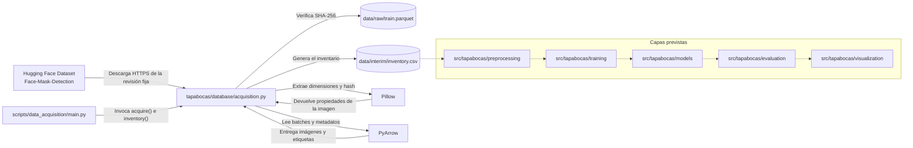
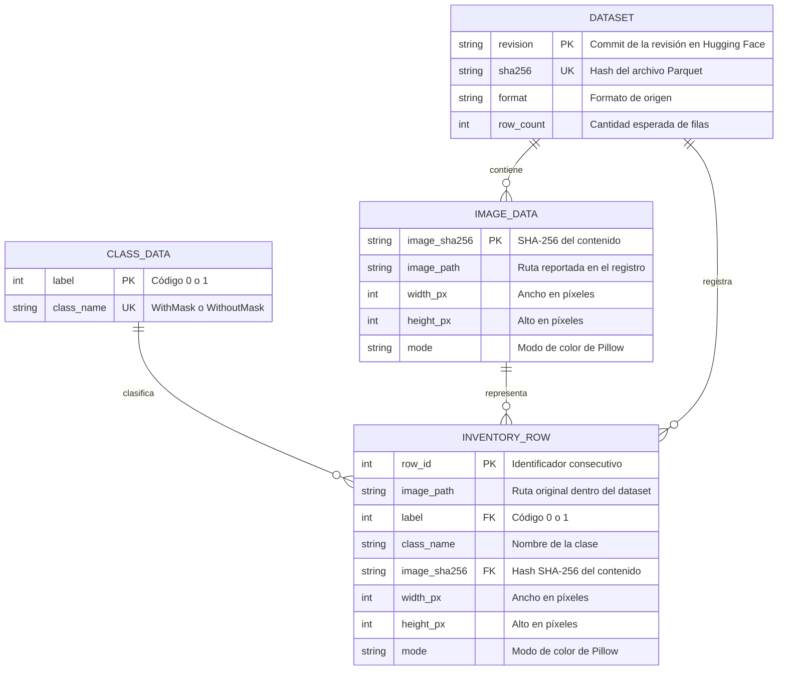
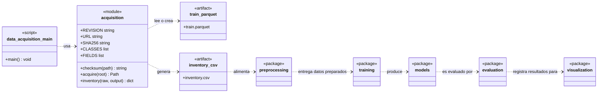

# Arquitectura y modelo de datos

Este documento describe la arquitectura actual del proyecto clasificador de tapabocas y el modelo lógico de los datos usados por el proceso de adquisición e inventario.

## Diagrama de arquitectura

El flujo implementado descarga una revisión fija del conjunto Face-Mask-Detection, conserva una copia local en formato Parquet y genera un inventario tabular en CSV.

### Responsabilidades

- **Fuente externa:** aloja el archivo Parquet de la revisión documentada.
- **Script de adquisición:** establece la raíz del proyecto y coordina descarga e inventario.
- **Módulo de adquisición:** valida la revisión y el SHA-256, verifica las clases y transforma cada registro del conjunto en una fila del inventario.
- **Almacenamiento local:** separa el archivo fuente original en `data/raw` y el resumen procesado en `data/interim`.
- **Preprocesamiento, entrenamiento y evaluación:** cuentan con módulos previstos en `src/tapabocas`; su integración debe partir del inventario generado.

## Diagrama de entidad relacion

El modelo representa conceptualmente el conjunto adquirido y el contenido de `inventory.csv`. La entidad `Dataset` corresponde a una revisión fija, `InventoryRow` corresponde a cada fila del CSV y `Image` identifica imágenes por su SHA-256.

### Reglas del modelo

- El conjunto tiene exactamente 11.792 filas para la revisión configurada.
- `WithMask` corresponde a la etiqueta `0`; `WithoutMask` corresponde a la etiqueta `1`.
- `row_id` identifica cada observación del inventario y comienza en cero.
- `image_sha256` permite detectar imágenes repetidas.
- Una imagen puede aparecer en varias filas si el conjunto contiene duplicados; un conjunto de hashes conflictivos indica que una misma imagen tiene etiquetas distintas.
- El modelo no almacena los bytes de la imagen en una base de datos relacional: estos permanecen dentro de `data/raw/train.parquet`.

## Diagrama UML del proyecto

La siguiente vista UML representa los módulos actuales y los módulos previstos por la estructura del paquete `tapabocas`.

