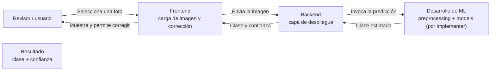

# Despliegue del clasificador de tapabocas (plan)

> Estado: documento de planeación. Describe el despliegue que se quiere lograr; todavía no hay servicio web, modelo entrenado ni código de despliegue en esta rama.

## Infraestructura

- **Nombre del modelo:** clasificador de imágenes con y sin tapabocas (prototipo académico).
- **Plataforma de despliegue (prevista):** servicio web pequeño compuesto por un frontend y un backend que actúan como capa de despliegue. El backend se comunicará con el desarrollo de machine learning que se implementará más adelante. Ejecución local prevista; sin proveedor de nube ni framework fijado en este momento.
- **Requisitos técnicos (estimados):**
  - Python y el entorno definido por `pyproject.toml`.
  - Dependencias de procesamiento de imágenes y de la capa web, por definir e incorporar cuando se implementen.
  - Módulos de ML previstos en `src/nombre_paquete/preprocessing`, `src/nombre_paquete/models` y `src/nombre_paquete/training`; hoy vacíos en esta rama.
  - Un artefacto de modelo entrenado, todavía no generado.
- **Requisitos de seguridad (previstos):** prototipo sin autenticación; las imágenes se procesan en memoria y no se persisten en el servidor; antes de usar fotografías reales o exponer el servicio debe revisarse el consentimiento de las personas y las condiciones de uso de los datos.
- **Diagrama de arquitectura (previsto):**

La interfaz y el backend son la capa de despliegue; el modelo y su preprocesamiento son una capa independiente que se conectará mediante el contrato descrito en `src/nombre_paquete/visualization/`.

## Código de despliegue (previsto)

- **Archivo principal:** aún no existe. Está previsto un punto de entrada en el backend que iniciará el servicio web; el frontend será servido por la misma aplicación o por un servidor estático simple, según se decida al implementar.
- **Rutas de acceso previstas:**
  - `src/nombre_paquete/visualization/`: documentación de la capa de despliegue y, en el futuro, el código del frontend y del backend.
  - `src/nombre_paquete/preprocessing/`, `src/nombre_paquete/models/`, `src/nombre_paquete/training/`: desarrollo de machine learning que alimentará las predicciones.
  - `docs/deployment/deploymentdoc.md`: este plan.
- **Variables de entorno previstas:** `APP_HOST`, `APP_PORT`, `MODEL_PATH`. No tienen valores asignados todavía y deben documentarse con su significado al implementar el servicio.

## Documentación del despliegue (instrucciones previstas)

- **Instalación:** crear el entorno Python, instalar el proyecto definido en `pyproject.toml` y añadir las dependencias que se seleccionen para la capa web y el procesamiento de imágenes.
- **Configuración:** definir `APP_HOST`, `APP_PORT` y `MODEL_PATH` en el entorno de ejecución; verificar que la ruta del artefacto del modelo sea accesible.
- **Uso:** iniciar el servicio, abrir la interfaz en el navegador, cargar una fotografía con un rostro principal visible y leer la clase estimada junto con su confianza. El revisor podrá corregir el resultado desde la propia interfaz. Las entradas grupales, ambiguas o sin rostro quedan fuera del protocolo previsto.
- **Mantenimiento:** registrar cambios de dependencias y de contrato de la API, versionar el artefacto del modelo, conservar los logs de predicciones y errores, y repetir la verificación de extremo a extremo después de cada actualización.

### Verificación prevista antes de dar el servicio por listo

1. El servicio inicia con las variables de entorno documentadas.
2. La interfaz carga y envía una imagen de prueba.
3. El backend invoca al módulo de ML y recibe una clase válida.
4. La respuesta incluye clase y confianza y se muestra en la interfaz.
5. La corrección humana queda registrada.
6. Se documentan los errores y su comportamiento esperado.

## Estado y próximos pasos

| Paso | Estado |
| --- | --- |
| Documentar el despliegue deseado | Hecho en este documento |
| Organizar la documentación de la capa web | Previsto en `src/nombre_paquete/visualization/` |
| Implementar preprocesamiento y modelo | Pendiente |
| Implementar backend y frontend | Pendiente |
| Probar el servicio de extremo a extremo | Pendiente |
| Publicar el servicio | Pendiente |

Este documento se actualizará cuando el servicio pase de ser una propuesta a una implementación ejecutable.
